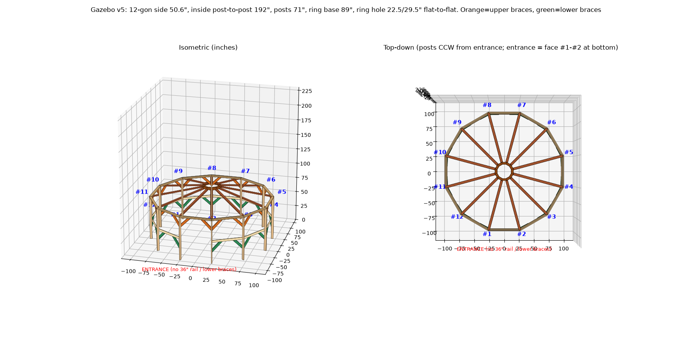
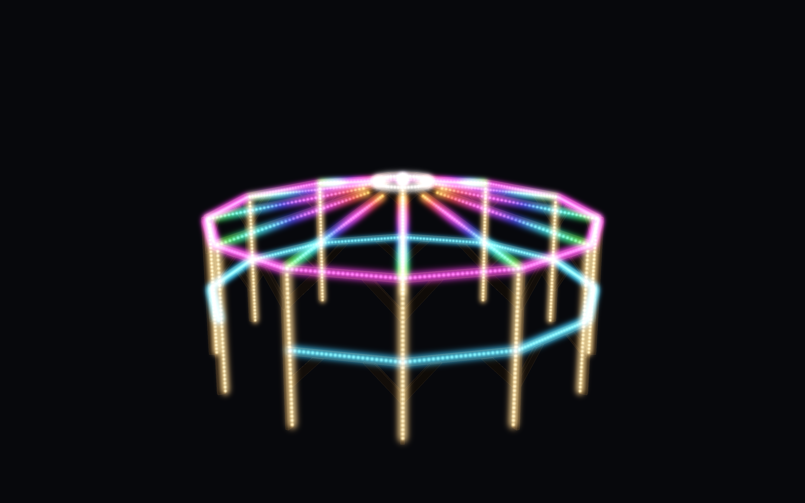
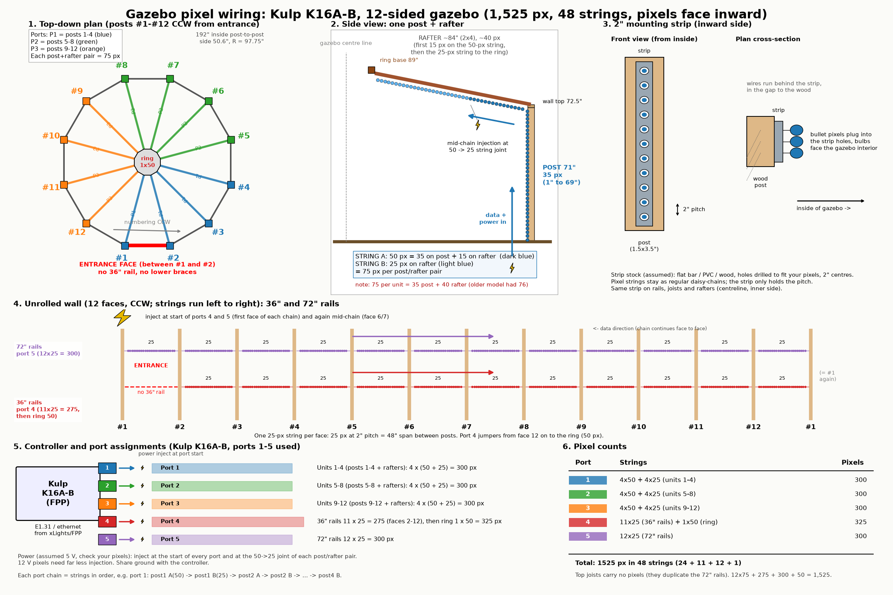

# Gazebo xLights

A 12-sided garden gazebo modeled in 3D and turned into a **1,525-pixel (2" spacing)** xLights model with 14 ready-made animations (`.fseq`) for playback on a Kulp controller running FPP.

> **Status: nothing here has been tested in xLights or on FPP/Kulp hardware.** Files were generated by script. See [Caveats](#caveats).




## Layout of this repo
| Path | What |
|---|---|
| `model/` | `gazebo.xmodel` (xLights custom 3D model), `gazebo_pixels.csv` (every pixel's x/y/z in inches), `gazebo_v5.obj` (3D mesh), `PACKAGE_NOTES.md` (auto-generated notes) |
| `renders/` | Model screenshots (v5 + close-up) and night renders from several camera positions |
| `sequences/` | 14 single-animation `.fseq` files + `gazebo_all.fseq` (first 7, 70 s) + `gazebo_calm.fseq` (calm 7, 140 s) |
| `previews/` | GIF previews of every animation |
| `animations/README.md` | Animation catalog + ideas backlog |
| `docs/hue-integration.md` | Untested plan for Hue / Home Assistant control |
| `scripts/` | Python that generates everything (run from repo root) |

## Dimensions and assumptions (inches)
All derived from your measurements and photo; anything marked *assumed* was my choice.
- **Plan:** regular 12-gon. Inside distance post #1 to post #7 (opposite posts, inside faces) = **192"**. Posts are 3.5" deep radially, so post-centre corner-to-corner = 195.5", post-centre circumradius **97.75"**, side length (centre to centre) **50.6"**.
- **Posts:** 12 posts, 2x4 (1.5" x 3.5", 3.5" radial), **71"** tall on the ground. Numbered #1-#12 counterclockwise from above, starting at the entrance. The entrance face is between #1 and #2 (centred at -90°, the -y side).
- **Top joists:** 2x4 laid flat (1.5") on top of the posts, 71"-72.5". Wall top is **72.5"**. They carry **no pixels** (they would duplicate the 72" rails).
- **Rails:** 1x4 (0.75" x 3.5") centred at **72"** (all 12 faces) and **36"** (11 faces; none on the entrance face). *Assumed:* centred at those heights, in the post-centreline plane.
- **Braces:** 2x4 at 45°, in the rail plane, cut flush to post face and rail underside (parallelograms). Upper set: vertex on post at 56" up to the 72" rail. Lower set: vertex at 20" up to the 36" rail (none on the entrance face). *Assumed* from the photo; no pixels go on braces.
- **Roof (open framing, no solid roof):** center ring is a 12-gon with base at **89"**, 3.5" tall (*assumed*), inside **22.5"** and outside **29.5"** flat-to-flat (*assumed* flat-to-flat). 12 rafters (2x4), one over each post, from wall top (72.5") to the ring's outer corner at 89". Rafter length computes to **84.1"**, matching the measured 84".

## Pixel layout
**1,525 pixels (RGB, 4,575 channels), 48 strings.** No pixels on braces or top joists. Pixels face inward (toward the center), on the inner side of each member's centerline. Posts and rails are at 2" spacing; the ring has 50 pixels at about 1.7".

> **Update (model regenerated):** an earlier version of this package had 1,800 pixels including 288 top-joist pixels and different string lengths. Those files were replaced: the model, pixel table, sequences, previews and renders in this repo all use the 1,525-pixel layout below. If you have older copies, discard them.

Node order **= wiring order**: posts and rafters are interleaved per "unit" so every port is one contiguous run.

| Nodes | Member | Count | Notes |
|---|---|---|---|
| 1-900 | 12 units: post k, then rafter k | 12 x 75 | post = 35 px bottom (1") to top (69"); rafter = 40 px wall to ring (~84"). String A (50 px) = 35 post + 15 rafter; string B (25 px) = remaining 25 rafter px |
| 901-1175 | 36" rails | 11 x 25 | faces 2-12 (none on the entrance face), 25 px = 48" span |
| 1176-1225 | Center ring | 50 | around the ring CCW |
| 1226-1525 | 72" rails | 12 x 25 | faces 1-12 |

Member totals: posts 420, rafters 480, 36" rails 275, 72" rails 300, ring 50 = 1,525. (An earlier 3D model had 76 px per post/rafter unit, 35 + 41. The hardware plan is 75, so the model now uses 40 rafter px.)

Node n in `gazebo.xmodel` is row n of `model/gazebo_pixels.csv` (start channel and real x/y/z; origin at the center on the ground, +z up).

## Wiring plan (Kulp K16A-B controller running FPP)
Full diagram: [`docs/wiring_diagram.png`](docs/wiring_diagram.png), notes in [`docs/wiring.md`](docs/wiring.md).



| Port | Content | Pixels | Nodes |
|---|---|---|---|
| 1 | Units 1-4 (posts 1-4 + rafters): 4 x (50 + 25) | 300 | 1-300 |
| 2 | Units 5-8 | 300 | 301-600 |
| 3 | Units 9-12 | 300 | 601-900 |
| 4 | 36" rails (11 x 25 = 275), then ring (50) | 325 | 901-1225 |
| 5 | 72" rails (12 x 25) | 300 | 1226-1525 |

- Totals: 1,525 pixels, 48 strings (24 post/rafter + 11 + 12 + 1), 4,575 channels. Over E1.31 that is 9 universes at 170 pixels (8 full + 165 px).
- The K16A-B has 16 ports (check the spec sheet); only 5 are used. Port 4 carries 325 px; if you prefer all ports at 300 or less, put the ring on its own port 6.
- Power: pixel voltage assumed 5 V (check yours). Inject at the start of every port and at the 50 -> 25 string joint of each post/rafter unit; 12 V pixels need much less.
- Pixels plug into 2"-pitch mounting strips on the inward side of the posts, rails and rafters (see the diagram, panel 3).
- In FPP, set the pixel outputs (Channel Outputs) per port above, start channel 1, same order. The `.fseq` files assume channel 1 = pixel 1 red.

## Importing the model into xLights
1. xLights > Layout > Models > **Create a new Custom model** (or the Import Custom Model option) and select `model/gazebo.xmodel`.
2. Check the model is 3D: width 189, height 92, depth 189 (1 cell = 1"), 1,525 nodes. Set the string type to RGB nodes and the start channel as needed.
3. Assign it to your controller ports per the table above.
4. If the import fails or the nodes look wrong, create a 3D custom model with the same width/height/depth and rebuild node positions from `gazebo_pixels.csv`.
5. The `.fseq` files are not editable xLights sequences; use them for FPP playback, or build effects on the model in xLights.

## Playing the sequences on FPP
1. Copy the `sequences/*.fseq` files to FPP's sequences folder (File Manager).
2. Make a playlist; put the sequence you want in it and set it to loop.
3. Make sure the FPP output channel range starts where the model starts and covers 4,575 channels.
4. Format: FSEQ v2, uncompressed, 20 fps (50 ms), 4,575 channels per frame. Single animations are 10 s (first seven) or 20 s (calm seven, loopable).

## Regenerating everything
From the repo root:
```
python -m venv .venv && . .venv/bin/activate && pip install -r requirements.txt
python scripts/xl_model.py        # model/gazebo.xmodel, CSV
python scripts/xl_anim.py         # first 7 sequences + gazebo_all.fseq
python scripts/xl_anim2.py        # calm 7 sequences + gazebo_calm.fseq
python scripts/xl_preview2.py     # GIF previews (needs the build/ frames from the two steps above)
python scripts/night_cam.py       # night renders
python scripts/g5.py              # 3D renders and OBJ
python scripts/wiring_diagram.py  # docs/wiring_diagram.png
```
All scripts run from the repo root and write to relative folders. Working files go to `build/` (git-ignored).

## Size and Git LFS
The tracked content is about 80 MB: sequences ~44 MB, previews ~29 MB, renders and model ~7 MB. GitHub rejects files over 100 MB and warns over 50 MB, so none is a problem alone, but total is over 50 MB. Consider Git LFS for `*.fseq` and `*.gif`:
```
git lfs install
git lfs track "*.fseq" "*.gif"
```
(Do this before the first commit that contains them. Not set up here.)

## Caveats
- **Not tested in xLights, FPP or on a Kulp controller.** I could not run xLights here. The `.xmodel` is valid XML in the classic `<custommodel parm1 parm2 Depth CustomModel=...>` format. I didn't use `CustomModelCompressed`, whose exact format I wasn't sure of.
- The FSEQ v2 header (32 bytes, uncompressed, 50 ms step) was written from the spec as I remember it. FPP should be able to play it, but I haven't confirmed that.
- A custom model can't store "pixels face inward"; the CSV positions are the real locations. 3D positions are rounded to 1" cells (4 collisions nudged 1 cell in +x).
- Previews and renders are from my own renderer, not xLights. Preview colors will differ from real pixels.
- The ring height (3.5"), 1x4 rail centering, and brace geometry are my assumptions from your photo and measurements; verify against the build.
- Brace-pixel exclusion, wiring order and the port plan are suggestions; confirm against your controller and wire direction.
