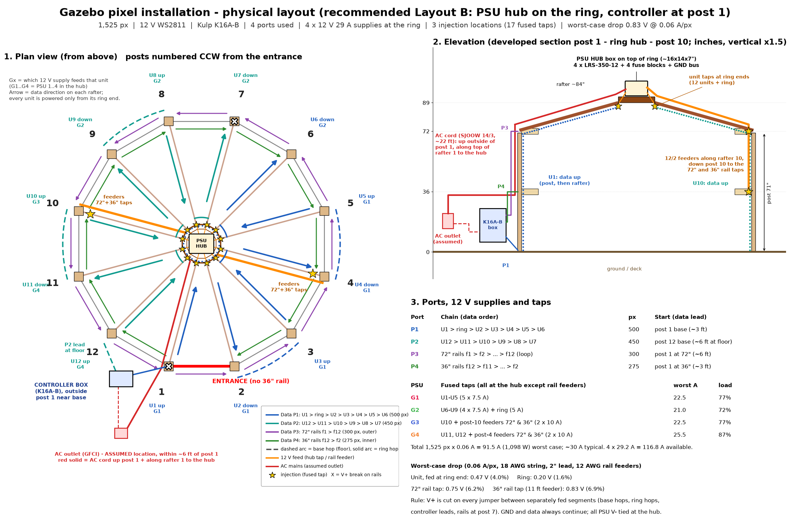

# Physical hardware layout: gazebo pixel installation

> **Superseded by [physical_layout_v3.md](physical_layout_v3.md)** (Layout F v3: Kulp K4-PB with 4 ports in the ring box, supplies on the ground). The K16A-B referenced below has been replaced by the K4-PB.

**Status: design, untested.** This replaces the port and power plan in `wiring.md` (that plan used 0.04 A/px, 5 ports and injection from the ground). The geometry and string plan are unchanged: 1,525 px, 48 strings, 12 V WS2811 bullets at 2" pitch facing inward. To regenerate the diagram and numbers, run `python scripts/physical_layout.py docs/physical_layout.png` and `python scripts/power_calc.py`.

## 1. Recommendation (Layout B)

**Supplies go in a hub box on top of the ring. The controller goes in a small box at the base of post 1. Units run as up/down pairs and get 12 V only at their ring ends.**

- **Hub box** (on a plywood plate bolted to the top of the center ring): 4 x Mean Well LRS-350-12, 4 ATO fuse blocks and a common GND bus. All 12 rafters meet here, so every unit's power tap is a lead of about 2 ft. A single AC cord comes up the outside of post 1 and along the top of rafter 1. **No heavy DC trunk is needed.**
- **Controller box** (outside face of post 1, near the base, next to the assumed outlet): K16A-B, BeagleBone, a small 12 V supply for the controller, and Ethernet. Every data lead starts within about 8 ft of it. Nothing that needs servicing sits at height.
- **Data:** 4 ports are used and 12 are spare.

| Port | Data order | px | Start | Frame time |
|---|---|---|---|---|
| P1 | U1 up, ring (50), U2 down, *base hop f2*, U3 up, *ring hop*, U4 down, *base hop f4*, U5 up, *ring hop*, U6 down | 500 | post 1 base (lead ~3 ft) | 15 ms (max ~65 fps) |
| P2 | U12 up, *ring hop*, U11 down, *base hop f10*, U10 up, *ring hop*, U9 down, *base hop f8*, U8 up, *ring hop*, U7 down | 450 | post 12 base (lead ~8 ft at floor along face 12) | 13.5 ms |
| P3 | 72" rails f1, f2 ... f12 (full loop, CCW) | 300 | post 1 at 72" (~6 ft) | 9 ms |
| P4 | 36" rails f12, f11 ... f2 (CW) | 275 | post 1 at 36" (~3 ft) | 8 ms |

"Up" means the data runs from the post base to the ring; "down" means it runs from the ring to the base. A unit is post k plus rafter k: 75 px, about 155". Base hops are about 5 ft long, run at floor level on faces 2, 4, 8 and 10, and none crosses the entrance. Ring hops are about 1 ft between adjacent rafter ends; the ring's flat side is ~7.9". The largest port is 500 px, well under the ~680 px at 40 fps guideline and Kulp's 800 px at 40 fps. Frame time = px x 30 µs (WS2811 at 800 kHz).

- **Power:** 17 fused taps at 3 injection locations: the hub (12 units + ring) and posts 4 and 10 (72" and 36" rail taps). The rail taps are fed by 12/2 cables run from the hub along rafters 4 and 10. Each tap feeds at most 75 px in each direction.
- **V+ isolation rule:** every power segment has exactly one feed. V+ is cut on every jumper between separately fed segments, and GND and data always continue. That covers 17 data-only jumpers: the 4 controller leads, 4 base hops, 5 ring hops, U1>ring and ring>U2, and the 72" and 36" rail joints at post 7. On the 72" loop, the f12/f1 joint at post 1 is the chain's start and end, so it is not connected. All PSU V- terminals are tied together at the hub. The controller's port V+ is not connected to any string, which avoids back-feeding the K16A-B's 5 A eFused ports.

### Why this layout wins
1. **Shortest copper.** All 12 rafter ends meet within ~15" of the hub, so 13 of the 17 taps are 2 ft leads, and the other 4 are 8 to 11 ft. The only long cable is one AC cord, which carries ~10 A at 120 V instead of ~90 A at 12 V.
2. **Within the 1.0 V drop limit everywhere** at the 0.06 A/px worst case: at most 0.83 V (6.9%). The ground-based alternatives reach 1.1 to 1.3 V or need 8 AWG.
3. **No return jumpers.** Pairing up/down runs means no unit ever needs a 14 to 17 ft jumper from the ring back to the next post base. There are 4 short base hops and 5 short ring hops.
4. **One power segment per unit.** Each fuse protects one 4.5 A segment, so a fault takes out only one unit or one rail section.

## 2. Candidate layouts compared

| | A: everything at post 1 base, DC trunk to a passive ring hub | **B: PSU hub on the ring, controller at post 1 (recommended)** | B': controller and PSUs both at the ring | C: distributed PSUs at posts 1/4/7/10 | D: current repo plan (5 chained ports, ground injection) | E: 12 independent home runs |
|---|---|---|---|---|---|---|
| Long cables | 3 x 10 AWG pairs up the trunk (~15 ft), 2 x 10 AWG perimeter feeders (~20 ft) | 1 AC cord (~22 ft) | 1 AC cord + Ethernet up the trunk; rail data down rafter 1 | ~50 ft of AC cord around the perimeter to 3 remote boxes | 9 ring-to-next-base jumpers (~17 ft each, ~150 ft) | 12 perimeter runs, ~150 ft of 14 AWG 3-wire |
| 12 V copper (approx.) | ~170 ft 10 AWG + ~40 ft 14 AWG | 38 ft 12/2 + 26 ft 14/2 | same as B | ~80 ft 14/12 AWG | port feeds + mid-chain feeds from the ground | ~150 ft 14 AWG + rails |
| Injection locations / taps | 3 / 17 | **3 / 17** | 3 / 17 | 12 post bases | 8 (as drawn) | 12 + rails |
| Worst drop @ 0.06 A/px | 1.13 V (units), 1.30 V (36" rails) | **0.83 V** | 0.83 V | ~0.6 V | 2.6 V (150 px fed one way) | 1.04 V |
| Mains at height | no | yes (GFCI, sealed box) | yes | no | no | no |
| Service access to controller | good | **good** | ladder | good | good | good |
| Enclosures | 1 + passive fuse box | 2 | 1 | 4 | 1 | 1 |
| Verdict | Fallback if mains at 8 ft is unacceptable; needs PSUs set to ~12.6 V or 8 AWG | **Best overall** | Fewer boxes, but controller is hard to reach and Ethernet must run up | Too many boxes and AC runs | Fails the drop limit; long return jumpers | Most cable; 4.5 A per port is close to the 5 A eFuse limit |

**Ring as the data hub:** feeding data from the center (B') only saves the ~20 ft of short data leads at post 1, and it costs controller access plus an Ethernet run up the trunk. The up/down pairing already puts every data start at a post base near the controller. **Power, not data, should come from the center.**

**Paired runs vs. 12 independent home runs:** a 150-px pair fed from one end drops 1.56 V, which fails. Fed at the ring (its middle), it drops 0.38 V. Pairing therefore works because injection is at the ring. Independent home runs (E) need ~150 ft of cable on the ground and 12 ports.

## 3. Power and voltage-drop calculation

Assumptions: 0.06 A/px at full white. The string wire is 18 AWG (6.385 mΩ/ft per conductor), with 2" of lead per pixel; the loop counts V+ and GND. Each mated 3-pin connector adds 10 mΩ of loop resistance, and a rail-to-rail jumper adds 6" of wire plus a connector. The ladder model sums the current through each segment.

| Segment (one direction from the tap) | Feed | Feed drop | String + connectors | **Total, worst case** | Typical (~1/3) | If the lead is 4"/px |
|---|---|---|---|---|---|---|
| Unit, 75 px, fed at ring end | 2 ft 14 AWG, 4.5 A | 0.09 V (incl. T) | 0.38 V | **0.47 V (4.0%)** | 0.16 V | 0.83 V |
| Ring, 50 px, fed at one point | 2 ft 14 AWG, 3 A | 0.06 V | 0.14 V | **0.20 V (1.6%)** | 0.07 V | 0.33 V |
| 72" rails, 3 faces (75 px) from tap at post 4/10 | 8 ft 12/2, 9 A | 0.32 V | 0.43 V | **0.75 V (6.2%)** | 0.25 V | 1.10 V |
| 36" rails, 3 faces from tap at post 10 | 11 ft 12/2, 9 A | 0.40 V | 0.43 V | **0.83 V (6.9%)** | 0.28 V | 1.19 V |

Reference cases: 75 px from one end, bare string: 0.35 V. 150 px fed from one end: 1.56 V. 300 px fed from the start only: 5.7 V. So **each tap can feed at most 75 px in each direction**, which makes 11 taps the theoretical minimum (1,525 / 150). The design uses 17 because all 13 unit and ring taps share one location and cost only a 2 ft lead each. **Possible further reduction:** one 15 A tap per up/down pair (at the ring junction) would bring the hub to 7 taps, at the cost of 9 A through a single T.

If your strings have 4" leads or 20 AWG wire, upgrade the four rail feeders to 10 AWG (a 0.1 V gain) and set the PSUs to 12.3 to 12.4 V.

**Supply loading** (Mean Well LRS-350-12: 12 V, 29.2 A, adjustable 10.2 to 13.8 V; set to 12.3 V):

| PSU | Fused outputs | Worst A | Load |
|---|---|---|---|
| G1 | U1, U2, U3, U4, U5 (5 x 7.5 A) | 22.5 | 77% |
| G2 | U6, U7, U8, U9 (4 x 7.5 A) + ring (5 A) | 21.0 | 72% |
| G3 | U10 (7.5 A) + post-10 72" and 36" feeders (2 x 10 A) | 22.5 | 77% |
| G4 | U11, U12 (2 x 7.5 A) + post-4 72" feeder (10 A, 9 A load) + 36" feeder (10 A, 7.5 A load) | 25.5 | 87% |
| **Total** | 17 outputs | **91.5 A (1,098 W)** | 78% of 116.8 A |

AC input at worst case: 1,098 W / 0.88 efficiency (assumed) ≈ 1,250 W plus the controller ≈ **10.5 A at 120 V**. Typical: ~3.6 A. PSU heat in the hub box is ~150 W at sustained full white and ~50 W in typical use. A brightness cap in FPP/xLights (e.g. 80%) is cheap insurance for heat and fuses.

## 4. Bill of materials (recommended layout)

| Item | Qty / length | Notes |
|---|---|---|
| Hub enclosure, NEMA 4X polycarbonate ~16 x 14 x 7" with back plate | 1 | 2 breather vents; bottom-entry glands (1 AC, 17 DC) or a multi-cable gland plate; on a 3/4" exterior plywood plate on top of the ring; drip shield if there is no roof |
| Mean Well LRS-350-12 | 4 | set to 12.3 V; V- terminals tied together |
| ATO fuse block, 6-way, with negative bus | 4 | one per PSU (17 of 24 slots used) |
| ATO fuses | 12 x 7.5 A (units), 1 x 5 A (ring), 4 x 10 A (rail feeders), + spares | |
| 10 AWG red/black, PSU to fuse block | 5 ft each | |
| AC cord, SJOOW **12/3**, molded plug | 25 ft | 12 AWG so it is protected on either a 15 A or 20 A circuit; terminal block plus optional 10 A 2-pole breaker in the hub |
| 14 AWG 2-conductor outdoor (hub to ring ends) | 13 x 2 ft (buy 30 ft) | |
| 12 AWG 2-conductor outdoor, rail feeders | 8 + 11 + 8 + 11 = 38 ft (buy 50 ft) | runs along the tops of rafters 4 and 10 and down the outer faces of posts 4 and 10 |
| Power-injection T-connectors (3-pin pass-through + 2-wire tap) | 17 | 13 at the hub, 2 each at posts 4 and 10 |
| 3-wire 18 AWG pixel extensions | P1 3 ft, P2 8 ft, P3 6 ft, P4 3 ft; base hops 4 x 5 ft; ring hops and ring in/out 7 x 1 ft | 17 of them are built data-only (V+ cut, labelled); also rail joints at post 7 |
| Rail face-to-face jumpers | 0 to 21 x 1 ft | only if the string pigtails can't span the post gap |
| Controller enclosure (e.g. Bud NBF-32022 with Kulp plate) | 1 | K16A-B + BeagleBone + SD card, 12 V 4 A supply (e.g. LRS-50-12), 4 pigtails, Ethernet gland, 6 ft AC cord |
| GFCI outlet with in-use cover | 1 (existing, assumed) | 2 plugs: hub cord and controller cord |
| Cable clips, UV ties, split loom, drip loops | as needed | keep low-voltage on the opposite side of rafter 1 from the AC cord |

## 5. Assumptions and what to measure or confirm
1. **AC outlet location (ASSUMED):** a GFCI outlet within ~6 ft of post 1, outside the entrance. If it is elsewhere, put the controller box at the nearest post base. The AC cord still goes up that post and along its rafter to the hub. Also confirm whether the circuit is 15 A or 20 A, and whether it is shared.
2. **Mains at height:** a sealed box at ~8 ft over the seating area, on a GFCI circuit. Check that this is acceptable to you and meets local code. If not, use **Layout A**, which needs the PSUs set to ~12.6 V or an 8 AWG trunk to stay near 1 V.
3. **String wire gauge and lead length:** measure them. 18 AWG and 2"/px were assumed; many bullets use 20 to 22 AWG, which roughly doubles the string drop. Also confirm that pigtails reach across post gaps and between adjacent rafter ends at the ring.
4. **Pixel current:** clamp-meter one 50-px string at full white. The design assumes 0.06 A/px, i.e. 3.0 A per string.
5. **Supply efficiency and derating:** 88% was assumed. LRS-350 output derates above 50 °C ambient, so check the hub box temperature on a sunny day.
6. **Roof and structure:** confirm whether there is a roof over the ring (rain exposure) and that the ring can carry ~15 lb (plate, box and 4 PSUs).
7. **K16A-B port V+:** confirm your board revision and how to leave port V+ unused. The plan uses data+GND leads, with the controller powered from its own small supply.
8. **Ethernet:** confirm a wired path to post 1, or plan to use FPP Wi-Fi.
9. **Test before final mounting:** with one unit at full white, measure the voltage at the tap and at the far pixel. Expect about 12.3 V and 11.8 V.

## 6. Follow-up needed in the xLights model
The node order in `gazebo.xmodel` / `gazebo_pixels.csv` follows the old 5-port plan, so it has to be rewritten before you test with sequences:
- Units U2, U4, U6, U7, U9 and U11 are physically reversed (ring to base).
- P1 = U1, ring, U2 ... U6 and P2 = U12 ... U7.
- The 36" rails start at post 1 (f12 to f2, reversed).
- The 72" rails already match (f1 to f12, CCW from post 1).

**Number checks:** 6 x 75 + 50 = 500, 6 x 75 = 450, 12 x 25 = 300, 11 x 25 = 275, and 500 + 450 + 300 + 275 = 1,525. Supply groups: 22.5 + 21 + 22.5 + 25.5 = 91.5 A = 1,525 x 0.06.
