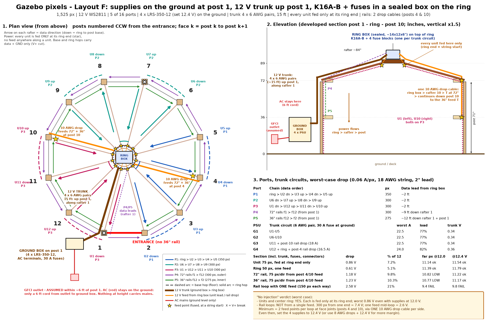

# Physical layout v2 (Layout F): supplies on the ground, controller on the ring

> **Superseded by [physical_layout_v3.md](physical_layout_v3.md):** the controller is now a Kulp **K4-PB** (4 ports) instead of the K16A-B, and the pixels are regrouped onto 4 ports. The power design and the drop numbers below are unchanged.

**Status: design only, untested.** This replaces the power and port plan in `physical_layout.md` (Layout B, supplies on the ring). The geometry and strings are unchanged: 1,525 px in 48 strings, 12 V WS2811 bullets at 2" pitch, facing inward. To regenerate, run `python scripts/physical_layout_v2.py docs/physical_layout_v2.png` and `python scripts/power_calc_v2.py`; every number in this document comes from the second script.

## 1. Summary

- **Ground box** (on the outside face of post 1, next to the assumed GFCI outlet). It holds the AC input, 4 x Mean Well LRS-350-12 set to **12.4 V**, and one 30 A fuse per supply. **Mains never leaves the ground.**
- **12 V trunk:** **4 x 6 AWG pairs** (one fused circuit per supply, 8 conductors), 15 ft one way. The route is up post 1, along rafter 1, into the ring box. That is the same copper as a single 1/0 AWG pair, split into 4 circuits, because LRS-350 supplies cannot be paralleled (no current-sharing mode).
- **Ring box** (sealed, on a plate on top of the center ring, ~89"). It holds the Kulp K16A-B with its BeagleBone and 4 fuse blocks, one per trunk circuit, each with a negative bus. All 12 rafters and the ring are within about 2 ft of it.
- **Units:** each of the 12 units (ring end, then rafter, then post, 75 px = 25-px string + 50-px string) is fed **only at its ring end**, which is a string start. The center ring (50 px) is fed at one point.
- **Rails:** **2 drop cables, 10 AWG 2-conductor.** One runs down rafter and post 4, the other down rafter and post 10. Each has a feed T at 72" and continues to a feed T at 36". Each feed T sits at a face-to-face string joint and powers 3 faces (75 px) in each direction. V+ is broken at post 7 on both rails and at post 1 on the 72" rail.
- **Data:** 5 of 16 ports. The unit and ring leads are about 2 ft. The two rail leads run about 9 ft and 12 ft down rafter 1.

### Is "no power injection" achievable at worst case (0.06 A/px)?

| Part | Verdict |
|---|---|
| 12 units + center ring | **Yes.** Each is fed once, at its ring end, with no feed anywhere along the string. The worst case is **0.86 V**, including the trunk, so the far pixel sees 11.14 V even with the supplies at 12.0 V. |
| 72" and 36" rail loops from one feed each | **No.** A 300 px loop fed from one end drops **7.4 V**. Fed at its middle (150 px each way) it drops **2.6 V**. It would only pass with a global brightness cap of about 29%. At typical show load (~1/3 of full white) it would be about 0.86 V, but that is not worst case. |
| Rail loops, minimum that works | **2 feed points per loop at string joints (posts 4 and 10)**, delivered by **one 10 AWG drop cable per side**: 2 cables, ~26 ft total. No feed goes into the middle of any string. Each feed lands where two 25-px face strings meet, so under your "feed at a string start" rule these are extra string-start feeds. In usual xLights wording, though, a feed at a chain joint *is* power injection, and the rails need 4 of them. |
| Rails with those feeds | 1.18 V (72") and 1.23 V (36"). This **exceeds a strict 1.0 V budget at 12.0 V** (far pixel 10.8 V). It **passes with the supplies set to 12.4 V** (far pixel 11.2 V; idle maximum 12.4 V). With 8 AWG drops it is 1.07 to 1.11 V. |

**Bottom line:** no injection is truly achievable for everything except the rails. The rails need 4 feed points (2 per loop) on 2 drop cables, plus a 12.4 V supply setting. The previous Layout B rail figures (0.75 V and 0.83 V) did not include a 15 ft trunk, had separate 12 AWG feeders and did not model fuse resistance. The trunk adds about 0.34 V to everything here.

## 2. Ports (all leads start at the ring box)

| Port | Data order | px | Data lead | Frame time |
|---|---|---|---|---|
| P1 | ring (50) > U2 down > *base hop f2* > U3 up > *ring hop* > U4 down > *base hop f4* > U5 up | 350 | ~2 ft | 10.5 ms |
| P2 | U6 down > *base hop f6* > U7 up > *ring hop* > U8 down > *base hop f8* > U9 up | 300 | ~2 ft | 9.0 ms |
| P3 | U1 down > *base hop f12* > U12 up > *ring hop* > U11 down > *base hop f10* > U10 up | 300 | ~2 ft | 9.0 ms |
| P4 | 72" rails f1 > f2 > ... > f12 (CCW from post 1) | 300 | ~9 ft down rafter 1 to post 1 at 72" | 9.0 ms |
| P5 | 36" rails f12 > f11 > ... > f2 (CW from post 1) | 275 | ~12 ft down rafter 1 and post 1 to 36" | 8.3 ms |

- "Down" means data runs from the ring to the post base, and "up" means the reverse. Power always comes in at the ring end, whichever way the data runs.
- Each unit port holds 4 units (2 down/up pairs), so every unit chain starts and ends at the ring.
- There are 6 base hops, each about 5 ft at floor level, on faces 2, 4, 6, 8, 10 and 12. None crosses the entrance (face 1). There are 3 ring hops of about 1 ft (rafters 3>4, 7>8 and 11>10).
- 11 ports are left spare. If you prefer, you could spread the load to 1 or 2 units per port.
- The 9 to 12 ft rail data leads are within the usual WS2811 range from a Kulp port. If the first pixel flickers, add a null pixel at the post 1 top.
- **V+ isolation rule:** every power segment has exactly one feed. Base hops, ring hops, controller leads, the rail breaks at post 7 and the 72" joint at post 1 carry **data + GND only** (V+ cut). The K16A-B port V+ goes to nothing. All V- conductors are common: tied at the ring-box negative buses, and at the ground box.

## 3. Power: circuits and voltage drop

Assumptions: 0.06 A/px. String wire is 18 AWG (6.385 mΩ/ft) with 2" of lead per pixel. Each mated connector adds 10 mΩ of loop resistance. Fuse cold resistance is typical ATO/MAXI (7.5 A ≈ 10 mΩ, 20 A ≈ 3.5 mΩ, 30 A ≈ 2.3 mΩ), plus lugs. Copper is taken at 20 °C; it reads about 8% higher at 40 °C. Pass means the far pixel is ≥ 11.0 V.

| Supply / trunk circuit | Loads (fused at the ring box) | Worst A | Load | Trunk drop (6 AWG pair, 15 ft) |
|---|---|---|---|---|
| G1 | U1-U5 (5 x 7.5 A) | 22.5 | 77% | 0.34 V |
| G2 | U6-U10 (5 x 7.5 A) | 22.5 | 77% | 0.34 V |
| G3 | U11 (7.5 A) + post-10 rail drop (20 A fuse, 18 A) | 22.5 | 77% | 0.34 V |
| G4 | U12 (7.5 A) + ring (5 A) + post-4 rail drop (20 A, 16.5 A) + K16A-B (5 A) | 24.0 (+ controller) | 82% | 0.36 V |
| **Total** | 16 fused outputs | **91.5 A, 1,098 W** | 78% of 116.8 A | |

| Section (worst case) | Trunk | Local feed | Fuse + T | String | **Total** | Far px @ 12.0 / 12.4 V | Typical (~1/3) |
|---|---|---|---|---|---|---|---|
| Unit 75 px, ring end only | 0.34 | 2 ft 14 AWG 0.05 | 0.09 | 0.38 | **0.86 V** | 11.14 / 11.54 | ~0.29 |
| Center ring 50 px, one feed | 0.36 | 0.03 | 0.08 | 0.14 | **0.61 V** | 11.39 / 11.79 | ~0.20 |
| 72" rail, 75 px/direction (10 AWG drop, 8 ft at 18 A) | 0.34 | 0.29 | 0.12 | 0.43 | **1.18 V** | 10.82 / **11.22** | ~0.39 |
| 36" rail, 75 px/direction (+3 ft at 9 A) | 0.34 | 0.34 | 0.12 | 0.43 | **1.23 V** | 10.77 / **11.17** | ~0.41 |
| Same with 12 AWG drop | | | | | 1.35 / 1.43 V | 36" low even at 12.4 V | |
| Same with 8 AWG drop | | | | | 1.07 / 1.11 V | 10.9 / 11.3 | |
| Rail loop, ONE feed mid-loop (150 px each way) | | | | 1.80 | **2.58 V** | **fails** | 0.86 |
| Rail loop fed from one end (300 / 275 px) | | | | 7.35 / 6.16 | | **fails** | |

**Rail rule:** from one feed, the 18 AWG rail string can carry about 90 to 100 px in one direction before the string alone uses about 0.7 V. Two feeds per loop (75 px each direction) is therefore the minimum.

**If your strings have 4" leads or 20 AWG wire:**
- Units become 1.22 V. That is still OK at 12.4 V (far pixel 11.18 V).
- Rails become 1.53 to 1.64 V, which is too low. Add feed T's at posts 1 and 7 too (4 feeds per loop, at most 50 px per direction, ~1.03 V), or use 8 AWG drops plus 4 AWG trunk pairs on G3 and G4.

### Trunk sizing (15 ft one way, 12 V)

| Option | A per pair | Drop | Notes |
|---|---|---|---|
| 1 pair 4 AWG | 91.5 | 0.77 V | Too much drop. Ampacity is marginal at 91 A. |
| 1 pair 2 AWG | 91.5 | 0.52 V | OK for ampacity. Needs one 100+ A supply or bus (LRS-350 can't be paralleled) and a ~125 A fuse. |
| 1 pair 1/0 AWG | 91.5 | 0.36 V | Same drop as the recommended option, but stiff, hard to terminate, and one big fuse and supply. |
| 2 pairs 4 AWG | 45.8 | 0.39 V | Needs 2 supplies of ~50 A each. |
| 4 pairs 8 AWG | 24 | 0.53 V | Lighter, but rails drop to ~1.4 V. |
| **4 pairs 6 AWG (recommended)** | **24** | **0.34 to 0.36 V** | One per LRS-350, each with a 30 A fuse at the ground box. ~53 mm² total, about the same as 1/0. Easy to terminate on 1/4" studs. A fault takes out only 1/4 of the show. |
| 4 pairs 4 AWG | 24 | 0.26 V | Saves ~0.1 V. Heavier. |

**Typical show:** about 30 A total (~7.5 A per circuit), and every drop is about 1/3 of the worst-case figures. A brightness cap in FPP/xLights (e.g. 80 to 85%) is cheap insurance for heat, fuses and drop.

### Option: 24 V trunk, step-down at the ring (evaluated, not recommended as primary)
- **Ground:** 4 x LRS-350-24. **Trunk:** about 48 A total (12 A per circuit), so 4 x 10 AWG pairs are enough. Trunk drop is 0.36 V of 24 (1.5%), and the regulators absorb it.
- **Top:** 4 x 24 to 12 V DC-DC converters (≥ 300 W each, potted/waterproof, set to 12.3 V) feed the same fuse blocks. The pixels still get 12 V.
- **Pros:** a lighter and cheaper trunk, and regulated 12 V at the ring regardless of trunk length. Rails then fall to about 0.85 to 0.9 V **even with a strict 12.0 V budget.**
- **Cons:** 4 more active parts at height. Converters dissipate ~58 W worst case (~19 W typical) inside a sealed box in the sun. Budget converters are a reliability risk, and a converter failure means getting on a ladder. It also costs more.
- **Use it if** 12.4 V supply trimming is not acceptable, or if the strings turn out to have thin wire.

## 4. Enclosures: weight, heat and water

- **Ground box:** 4 x LRS-350-12. **These have thermostatic fans** (on at ~50 °C), so the box must breathe. Use a ventilated or louvered weatherproof enclosure (NEMA 3R style) with bottom entry, mounted on post 1 with its bottom ≥ 12" above grade, not a sealed NEMA 4X. Heat is ~150 W at sustained full white and ~50 W typical. Shade it if you can. AC input at worst case: 1,248 W, **10.4 A at 120 V** (typical ~3.5 A).
- **Ring box:** sealed NEMA 4X polycarbonate, about 14 x 12 x 6", on a 3/4" exterior plywood plate bolted to the top of the ring.
  - **Weight:** about 10 to 11 lb (box 3.5, plate 3, controller 0.5, fuse blocks 1.5, lugs/fuses/wire 1.5, glands 0.5), plus the trunk ends. Support the trunk on the rafter with clips every 12" so the box does not carry it.
  - **Heat:** ~18 W worst (fuses, blocks, lugs, K16A-B ~8 W), ~6 W typical. Only solar gain matters, so choose a light-colored box and add a drip/sun hood.
  - **Water:** the roof is open framing, so the box gets direct rain. All entries go through the bottom: cable glands or multi-hole grommet glands (~21 cables, or a 1-1/4" conduit hub for the trunk). Add a drip loop on every cable, a breather vent (to stop condensation pumping), a desiccant pack, and dielectric grease on pixel connectors.
  - **Service:** the controller is at about 8 ft, so SD card swaps and resets need a ladder. Manage FPP over the network and keep a spare imaged SD card.
- **Safety:** AC is only at ground level, near the GFCI outlet. Everything at height is 12 V. Fault energy at height is still high: an unfused 6 AWG conductor at 12 V can supply hundreds of amps. That is why every trunk conductor is fused **at the supply end**, and every branch is fused at the ring box.

## 5. Bill of materials

| Item | Qty / length | Notes |
|---|---|---|
| Mean Well LRS-350-12 | 4 | Set to 12.4 V with no load. V- terminals tied to the ground-box GND bus. |
| Ground enclosure, ventilated/louvered weatherproof, ~20 x 16 x 8" | 1 | Bottom entry; mount on post 1, bottom ≥ 12" above grade. |
| AC: SJOOW 12/3 cord with molded plug, 6 ft; DIN terminal blocks; optional 15 A 2-pole breaker or switch | 1 | 12 AWG suits either a 15 A or 20 A circuit. Plug into the GFCI. |
| 30 A fuse + stud-type holder (MIDI/AMI or MAXI), at each supply V+ | 4 (+2 spare fuses) | Protects each trunk circuit. |
| **Trunk: 6 AWG fine-strand copper (welding/battery cable, UV-rated), red + black** | **4 x 16 ft red + 4 x 16 ft black (~128 ft)** | Label G1-G4. ~12 lb. Run in 1-1/4" liquid-tight non-metallic conduit or UV split loom, up the outside of post 1 and along the top of rafter 1. |
| 6 AWG x 1/4" ring lugs + adhesive heat shrink | 16 (+4) | 8 at each end. |
| Ring enclosure, NEMA 4X polycarbonate ~14 x 12 x 6" with back plate | 1 | Breather vent, desiccant, sun/drip hood, 3/4" ply mounting plate. |
| 6-way ATO fuse block with negative bus (e.g. Blue Sea 5025 class) | 4 | One per trunk circuit; V+ buses kept separate; negative buses bonded. 16 of 24 slots used. |
| ATO fuses | 12 x 7.5 A, 1 x 5 A (ring), 2 x 20 A (rail drops), 1 x 5 A (K16A-B), + spares | |
| Kulp K16A-B + BeagleBone + SD card | 1 | Powered from G4 via a 5 A fuse. Confirm the board's input range for 12 V. |
| 14 AWG 2-conductor outdoor (ring box to each unit's ring end + ring) | 13 x ~2.5 ft (buy 50 ft) | |
| Feed pigtails/T at unit starts (3-pin + 2-wire tap) | 13 | |
| **Rail drops: 10/2 SJOOW** | **2 x ~13 ft (ring box > rafter 4 / 10 > 72" > 36"; buy 30 ft)** | One cable per side. 72" tap in an IP68 3-way junction; the cable continues to 36". |
| Rail feed T's (power into a face-to-face joint, both directions) | 4 | Posts 4 and 10, at 72" and 36". |
| 18 AWG 3-wire extensions, **built data + GND only** (V+ cut, labelled) | P1-P3 3 x 2 ft; P4 1 x 9 ft; P5 1 x 12 ft; base hops 6 x 5 ft; ring hops + ring out 4 x 1 ft | |
| Rail V+ breaks | post 7 (72" and 36"), post 1 (72" start/end) | Data-only joint at post 7. |
| Ethernet: outdoor Cat6, router > ground box > up the trunk route, with gland | ~30-50 ft | Or FPP Wi-Fi. |
| Cable clips, UV ties, split loom, drip loops | as needed | Keep the data leads on the opposite side of rafter 1 from the trunk. |

**Copper summary:** 12 V trunk 128 ft of 6 AWG; drops 26 ft of 10/2; unit and ring leads ~33 ft of 14/2; data extensions ~60 ft. No long 12 V runs at floor level, and no AC at height.

## 6. Assumptions and open questions

1. **Outlet (ASSUMED):** a GFCI within ~6 ft of post 1, outside the entrance. If it is elsewhere, move the ground box and trunk to that post; the drops stay at posts 4 and 10 relative to post 1. Is the circuit 15 A or 20 A, and is it shared? Worst case is 10.4 A.
2. **"No injection":** do the 4 rail feed T's (2 per loop) fit what you meant by "only extra wiring down to the 2 rings"? If even those are unacceptable, the rails can only stay in spec with a ~29% brightness cap, or per-face feeds (more wire).
3. **Supply setting at 12.4 V:** confirm that your pixels' rated input allows 12.4 V. Most 12 V WS2811 bullets do. The alternative is the 24 V trunk option.
4. **String wire and leads:** 18 AWG and 2"/px are assumed; measure them. Thinner wire roughly doubles string drop, which brings in the fallback (feeds at posts 1 and 7 too).
5. **Pixel current:** clamp-meter one 50-px string at full white (assumed 3.0 A).
6. **Ring strength:** it must carry a ~10 to 11 lb box plus cable pull. Is there any cover over the ring?
7. **K16A-B:** confirm the board revision, the input voltage range, and that port V+ can be left unconnected.
8. **Access:** is a ladder trip to the controller (~8 ft) acceptable for service?
9. **Test before final mounting:** with one unit at full white, expect ~12.3 V at the ring-box fuse output and ~11.8 V at that unit's post base. With one rail side (both rails, posts 7 to 1 via post 10) at full white, expect ~11.3 V at post 7.

## 7. Follow-up in the xLights model
The node order has to follow the new chains:
- P1 = ring, U2, U3, U4, U5; P2 = U6 to U9; P3 = U1, U12, U11, U10.
- Units U1, U2, U4, U6, U8 and U11 are reversed (ring to base). U3, U5, U7, U9, U10 and U12 stay base to ring.
- The rails are the same as in Layout B: 72" f1 to f12, and 36" f12 to f2.

**Number checks:**
- Ports: 350 + 300 + 300 + 300 + 275 = 1,525 px.
- Circuits: 22.5 + 22.5 + 22.5 + 24 = 91.5 A = 1,525 x 0.06 A.
- Rail drops: post 10 carries 150 + 150 px = 18 A; post 4 carries 150 + 125 px = 16.5 A.
