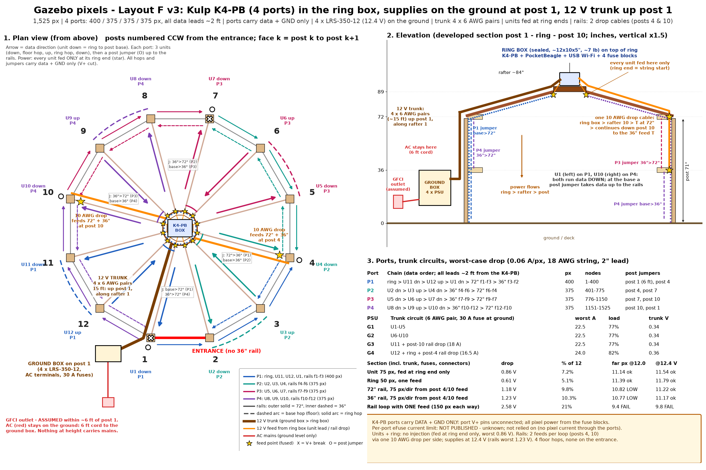

# Physical layout v3: Layout F with a Kulp K4-PB controller

> **Superseded by [physical_layout_v4.md](physical_layout_v4.md) (4-line plan, Kulp K4).** The model and sequences now follow v4; rebuild with `GAZEBO_LAYOUT=v3` for this order.

**Status: design only, untested.** This builds on `physical_layout_v2.md` (Layout F) and keeps its power design (ground box, trunk, ring-box fuses, rail drops; voltage-drop numbers unchanged). Two things change:
- **Controller:** a Kulp **K4-PB** (PocketBeagle cape) replaces the K16A-B.
- **Pixel grouping:** the 1,525 px are regrouped onto its **4 ports**.

The xLights model, CSV and sequences in this repo now follow the new chain order. To regenerate:
- `python scripts/physical_layout_v3.py docs/physical_layout_v3.png`
- `python scripts/power_calc_v2.py` (power is unchanged)
- `python scripts/xl_model.py`, `scripts/xl_anim.py`, `scripts/xl_anim2.py`, `scripts/xl_preview2.py`

## 1. K4-PB facts used, and how it is wired

| K4-PB (Kulp product page) | Consequence here |
|---|---|
| 4 local pixel ports, eFused, with LEDs. Each drives 800+ px at 40 FPS "with power injection". | The largest port is 400 px (12 ms per frame, ~80 FPS ceiling). Every port is under half the rating. |
| Board powered from the same supply as the pixels. 5 V / 12 V jumper, factory set to 12 V. | Feed it 12 V from trunk circuit G4 through a **3 A fuse** on the G4 ring-box block. Leave the jumper at 12 V. |
| Port power is switched through the eFuses. **Per-port eFuse current limit: not published (unknown).** | **No pixel power flows through the ports.** Each port's 3-pin lead carries **data + GND only**, and the **port V+ pin is left unconnected**. Every string gets V+/GND from the ring-box fuse blocks. The eFuse current monitoring and pixel counting will read ~0 A, which is expected. Unknown limit: **ask Kulp or check the manual before ever powering anything from a port.** |
| 3-pin UART header (DMX / PixelNet / Renard / LOR) | Spare. |
| Networking through a USB adapter (nano Wi-Fi, or USB Ethernet) | Use a nano USB Wi-Fi in the polycarbonate ring box, so **no Ethernet cable runs up the post**. USB Ethernet is an option for initial setup. |

**Ground reference:** each port's GND conductor ties the K4-PB ground to the first pixel's GND. That pixel sits ~2 ft from the ring-box negative bus that the board is powered from, so the offset is negligible. Hops and jumpers also carry GND (V+ cut) between separately fed segments. A little equalising current can flow in those 18 AWG GND conductors, which is normal and harmless at these drops. Do not leave out GND on any hop.

## 2. Port grouping (chosen)

Target: 1,525 / 4 ≈ 381 px per port. Units are 75 px; the ring is 50 px; the 72" loop is 12 faces x 25 px; the 36" C-loop is 11 faces x 25 px (no entrance face).

| Port | Data order | px | Nodes (channels) | Lead from K4-PB | Jumpers on the way |
|---|---|---|---|---|---|
| **P1** | ring (50, entered at rafter 11, once round CCW) > U11 down > *floor hop f11* > U12 up > *ring hop* > U1 down > *post 1 jumper base>72"* > 72" f1, f2, f3 (post 1 to 4) > *post 4 jumper 72">36"* > 36" f3, f2 (post 4 to 2, end) | **400** | 1-400 (1-1200) | ~2 ft | floor f11; post 1 (~6 ft), post 4 (~3.5 ft) |
| **P2** | U2 down > *floor hop f2* > U3 up > *ring hop* > U4 down > *post 4 jumper base>36"* > 36" f4, f5, f6 (post 4 to 7) > *post 7 jumper 36">72"* > 72" f6, f5, f4 (post 7 to 4, end) | **375** | 401-775 (1201-2325) | ~2 ft | floor f2; posts 4, 7 (~3.5 ft each) |
| **P3** | U5 down > *floor hop f5* > U6 up > *ring hop* > U7 down > *post 7 base>36"* > 36" f7-f9 (post 7 to 10) > *post 10 36">72"* > 72" f9-f7 (post 10 to 7, end) | **375** | 776-1150 (2326-3450) | ~2 ft | floor f5; posts 7, 10 |
| **P4** | U8 down > *floor hop f8* > U9 up > *ring hop* > U10 down > *post 10 base>36"* > 36" f10-f12 (post 10 to 1) > *post 1 36">72"* > 72" f12-f10 (post 1 to 10, end) | **375** | 1151-1525 (3451-4575) | ~2 ft | floor f8; posts 10, 1 |

**Totals:** 400 + 375 + 375 + 375 = 1,525 px, a spread of 25 px. Data leads are 4 x ~2 ft, all from the ring box. There are **4 floor-level hops** (faces 2, 5, 8 and 11, none on the entrance face 1, was 6), 4 ring hops of about 1 ft, and 8 vertical post jumpers (1 x ~6 ft + 7 x ~3.5 ft) on posts 1, 4, 7 and 10. All hops and jumpers carry **data + GND only** (V+ cut). "Down" means data runs ring > rafter > post base; power always enters at the ring end (unchanged from v2).

**FPP / K4-PB output setup:**

| Port | Start channel | Pixels | Universes (E1.31, 170 px each) |
|---|---|---|---|
| P1 | 1 | 400 | 1-3 |
| P2 | 1201 | 375 | 3-5 |
| P3 | 2326 | 375 | 5-7 |
| P4 | 3451 | 375 | 7-9 |

All ports are RGB WS2811.

### Why this grouping
- **Three units per port, then rails.** Odd unit counts (down, up, down) end each unit chain at a **post base**. From there, a ~3 ft jumper up the same post reaches the 36" rail (6 ft to the 72" at post 1). Each port then runs 3 faces out along one rail, steps up or down at the far post, and comes back 3 faces on the other rail. The rails become the **tail of each unit chain**. There are no long rail data leads (v2 had 9 ft and 12 ft leads down rafter 1), and no rail chain needs to start at the ring.
- **Balance:** 3 units (225 px) + 6 rail faces (150 px) = 375 on three ports. The fourth gets the ring and the 5 remaining faces (f1-f3 at 72" and f2-f3 at 36", since the 36" rail skips the entrance): 50 + 225 + 125 = 400.
- **Starts and ends.** Every chain *starts* at the ring with a ~2 ft lead. Each chain *ends* on a rail, the last thing in it, so nothing ever has to return to the ring. Ending at the ring is impossible for any chain that carries rails without a return jumper, so this is the best available.
- **Floor hops minimal.** One per port (unavoidable for an up/down unit pair), on faces 2, 5, 8 and 11. The entrance face 1 is avoided.
- **Power matches.** Rail feeds stay at posts 4 and 10. The rail V+ breaks of v2 (posts 1 and 7 on the 72" rail, post 7 on the 36" rail) now fall exactly at **chain boundaries**, so no rail joint needs a cut-V+ jumper. At each of the 4 rail feed points, the feed is a Y into the two string ends that meet there.

### Groupings considered and rejected

| Option | Ports (px) | Floor hops | Long data leads | Why not |
|---|---|---|---|---|
| **3 units + 6 rail faces per port (chosen)** | 400/375/375/375 | 4 | none | |
| 4 units/port on 3 ports + all rails on P4 | 350/300/300/575 | 6 | P4 ~9-12 ft down rafter 1, plus a 36"-to-72" link | Unbalanced. 575 px is fine for the K4 but 17 ms per frame. Long lead. |
| 6 units on each of 2 ports + one rail loop per port | 500/450/300/275 (ring on P1) | 6 | 2 x 9-12 ft | Unbalanced, long leads. |
| Rails as the hop (unit base > rail > next post base > unit up) | ~380 each | 0 | none | No floor hops, but ~2x the vertical jumpers, and rail order interleaves with units. Harder to install and debug. Worth it only if any floor hop is unacceptable. |

## 3. Power (unchanged from v2): drop tables

Assumptions: 0.06 A/px worst case; 18 AWG string wire with a 2" lead per pixel; 10 mΩ per connector; typical ATO/MAXI fuse resistance; copper at 20 °C. Pass means the far pixel is at least 11.0 V. Every unit is fed **only at its ring end**, and the rails at posts 4 and 10 through one 10 AWG drop per side. Supplies are 4 x LRS-350-12 set to 12.4 V, and the trunk is 4 x 6 AWG pairs over 15 ft.

| Supply / trunk circuit | Loads (fused at the ring box) | Worst A | Load | Trunk drop |
|---|---|---|---|---|
| G1 | U1-U5 (5 x 7.5 A) | 22.5 | 77% | 0.34 V |
| G2 | U6-U10 (5 x 7.5 A) | 22.5 | 77% | 0.34 V |
| G3 | U11 (7.5 A) + post-10 rail drop (20 A fuse, 18 A) | 22.5 | 77% | 0.34 V |
| G4 | U12 + ring (5 A) + post-4 rail drop (20 A, 16.5 A) + K4-PB (3 A fuse, <0.5 A) | 24.0 | 82% | 0.36 V |

Supply groups do not need to match data ports; power and data are independent.

| Section (worst case, includes trunk, fuses and connectors) | Total drop | Far pixel at 12.0 / 12.4 V | Typical (~1/3 load) |
|---|---|---|---|
| Unit 75 px, ring end only | 0.86 V | 11.14 / 11.54 | ~0.29 V |
| Center ring 50 px, one feed | 0.61 V | 11.39 / 11.79 | ~0.20 V |
| 72" rail, 75 px each way from post 4/10 (10 AWG drop) | 1.18 V | 10.82 / **11.22** | ~0.39 V |
| 36" rail, 75 px each way (+3 ft of drop) | 1.23 V | 10.77 / **11.17** | ~0.41 V |
| Rail loop with ONE feed (150 px each way) | 2.58 V | fails | 0.86 V |
| Rail loop fed from one end (300 / 275 px) | 7.35 / 6.16 V | fails | |

**Verdict (unchanged):**
- **Units and ring:** no injection is needed.
- **Rails:** they need 2 feed points per loop (posts 4 and 10), with the supplies set to 12.4 V. With 8 AWG drops the rails reach 1.07 to 1.11 V.
- **If the string wire is thinner than assumed** (4" leads or 20 AWG): units 1.22 V, rails 1.5 to 1.6 V. Add rail feeds at posts 1 and 7 too.

The full trunk-sizing and 24 V options are in v2 §3.

## 4. Enclosures

- **Ring box (smaller and lighter than v2):** about 12 x 10 x 5", NEMA 4X polycarbonate (was 14 x 12 x 6"), on a ~12 x 10" 3/4" plywood plate on top of the ring.
  - **Weight:** about **7 to 8 lb** (box 2.5, plate 2.5, K4-PB + PocketBeagle 0.2, 4 fuse blocks 1.5, fuses/lugs/wire 1.0, glands 0.3). That is down from ~10 to 11 lb.
  - **Heat:** ~12 W worst case (fuses, blocks and lugs ~10 W; K4-PB ~2 W), ~4 W typical.
  - **Contents:** K4-PB + PocketBeagle + SD card, nano USB Wi-Fi, and 4 x 6-way ATO fuse blocks with negative bus (one per trunk circuit, V+ kept separate).
  - **Cable entries, all bottom:** trunk (8 x 6 AWG through a 1-1/4" hub), 13 unit/ring leads, 2 rail drops and 4 data leads. That is 19 cables + trunk, was 21 + trunk + Ethernet.
  - **Weatherproofing:** breather vent, desiccant, sun/drip hood (the roof is open framing).
  - **Range check:** Wi-Fi through the polycarbonate box should be fine. Check signal strength at the ring before closing up.
- **Ground box (unchanged):** a ventilated weatherproof box (the LRS-350 has a fan) on post 1, bottom ≥ 12" above grade. Holds AC terminals, 4 x LRS-350-12 and 4 x 30 A fuses. Heat is ~150 W at full white (~50 W typical). **AC never leaves the ground.**

## 5. Bill of materials (changes from v2 marked **new** / **changed**)

| Item | Qty / length | Notes |
|---|---|---|
| **new:** Kulp K4-PB + PocketBeagle (or PocketBeagle 2) + SD card (FPP 7+) | 1 | Jumper stays at 12 V. Power from G4 via a 3 A fuse. **Port V+ pins not connected.** |
| **new:** nano USB Wi-Fi adapter (Linux/FPP supported; access-point capable) | 1 | Optional: a USB Ethernet adapter for setup. |
| **changed:** ring enclosure NEMA 4X ~12 x 10 x 5" + 3/4" ply plate ~12 x 10" | 1 | Breather vent, desiccant, hood. |
| 6-way ATO fuse block with negative bus | 4 | 16 of 24 slots used. |
| ATO fuses | 12 x 7.5 A (units), 1 x 5 A (ring), 2 x 20 A (rail drops), **1 x 3 A (K4-PB)**, + spares | |
| **changed:** 3-wire 18 AWG extensions, **built data + GND only** (V+ cut, labelled) | 4 port leads x 2 ft; 4 floor hops x 5 ft (faces 2, 5, 8, 11); 4 ring hops + ring-out x 1 ft; post jumpers 1 x 6 ft (post 1 base to 72") + 7 x 3.5 ft | About 60 ft total. The post jumpers run up the inside face of posts 1, 4, 7 and 10, beside the unit's pixels. |
| **removed:** P4/P5 9 ft and 12 ft rail data leads; Cat6 up the trunk route | | Wi-Fi at the ring instead. |
| Rail feed Y/T (power into the two string ends at a feed point) | 4 | Posts 4 and 10, at 72" and 36". |
| Unchanged from v2 | | 4 x LRS-350-12 (12.4 V); ventilated ground box; 6 ft 12/3 SJOOW AC cord; 4 x 30 A fuses; trunk 4 x 6 AWG pairs (~128 ft of 6 AWG) with 16 lugs; 13 x ~2.5 ft 14/2 unit and ring leads + 13 feed pigtails; 2 x ~13 ft 10/2 SJOOW rail drops with IP68 72" taps; clips, UV ties, loom, drip loops. |

## 6. Assumptions and open questions

1. **K4-PB per-port eFuse limit (unknown).** It is not relied on, because no pixel current passes through the ports. Confirm with Kulp before ever using port power. Also confirm that the K4-PB accepts the 12.4 V supply setting (it is powered from the 12 V pixel supply; 12.4 V is +3%).
2. **Leaving the port V+ pin unconnected:** confirm the K4-PB manual allows it. The FPP eFuse "pixel count" and "current" readouts will not work in this mode.
3. **Wi-Fi at the ring:** check signal and the adapter model. The fallback is a USB Ethernet adapter plus outdoor Cat6 up the trunk route.
4. **Post jumpers:** 8 vertical jumpers of 3.5 to 6 ft run beside the unit pixels on posts 1, 4, 7 and 10. Check the pigtail genders and that the 36"-to-72" step at the far post reaches.
5. **Ring start point:** the ring string's data enters near rafter 11 and runs CCW once round (in the model: ring pixel 43 of the geometric order is node 1). Mount the ring's first pixel there, or rotate the model's ring if it is mounted elsewhere.
6. Still open from v2: the outlet location (assumed post 1), string gauge and lead length, measured pixel current, whether the pixels allow 12.4 V, and the ring's load capacity.

## 7. What changed in the xLights files

- **Model** (`model/gazebo.xmodel`, `model/gazebo_pixels.csv`): node order is now the port order above (P1 nodes 1-400 ... P4 1151-1525).
  - The CSV gains a `port` column.
  - `pos_in_member` stays geometric (posts bottom to top, rafters wall to ring, rails post f to f+1, ring CCW from post 1), so reversed units are visible in the CSV.
  - Down units (U1, U2, U4, U5, U7, U8, U10, U11) run ring > rafter > post top > base.
- **Sequences** (`sequences/*.fseq`): regenerated with the new channel order.
  - The animations are defined by pixel position, so they look the same as before; only the channel mapping changed. Verified: `rainbow_chase` and `slow_ember_glow` are an exact re-permutation of the old files.
  - Effects that randomise per pixel (twinkle, candle and eye flicker, star twinkles) assign their random values by node number, so the sparkle pattern moves to different pixels but is statistically the same. `twinkle.fseq` is byte-identical.
- **Previews** (`previews/*.gif`): re-rendered from the new frames.
- **Number checks:**
  - Ports: 400 + 375 + 375 + 375 = 1,525.
  - Every pixel appears exactly once (asserted in `scripts/xl_common.py`).
  - Every consecutive-node gap over 4.5" is one of the planned jumpers: 4 floor hops of 50", 4 ring hops of ~10", ring-to-U11 7", 8 post jumpers of 35 to 71".
