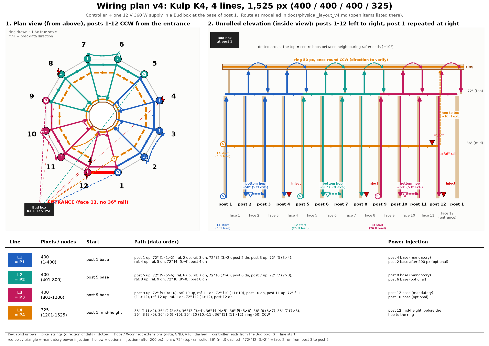
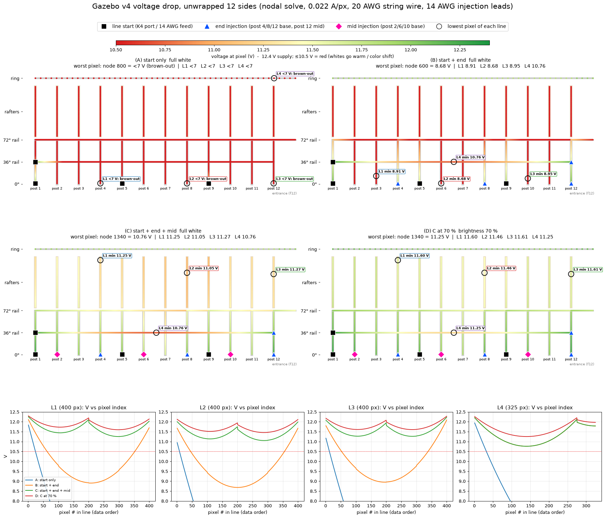

# Physical layout v4: 4-line plan (Kulp K4, one 12 V 360 W supply)

**Status: design only, untested.** This document turns the v4 wiring plan (written route + spreadsheet) into one consistent route.
The model (`model/gazebo.xmodel`, `model/gazebo_pixels.csv`), all `.fseq` sequences and the web preview now use this
node order. `GAZEBO_LAYOUT=v3` rebuilds the previous Layout F v3 order (see [physical_layout_v3.md](physical_layout_v3.md)).
Diagram: `python scripts/k4_ports_diagram_v4.py`. Power numbers: `python scripts/power_calc_v4.py`.

Numbering as everywhere in this repo: posts 1-12 counterclockwise seen from above, starting at the entrance. The entrance is
**face 12 (posts 12-1)** and has no 36" rail and no lower braces. Face f runs from post f to post f+1, and rafter ("ceiling joist") k sits on post k.
The v1-v3 docs and diagrams use an older numbering in which the entrance is face 1 (posts 1-2).
"Top horizontal" = the 72" rail, "mid-height horizontal" = the 36" rail.

## 1. Sources
**Written route (summary).**
- Lines 1-3 have 400 px each. Post 1 runs up, then the top horizontal post 1 > 2, then joist 2 up, a centre hop, joist 3 down,
  the top horizontal post 3 > 2, and post 2 down. There is an optional injection there, then a bottom hop to post 3. The pattern
  repeats, jogging 2 posts, with a mandatory injection at the bottom of post 4. Lines 2 and 3 are the same, shifted by 4 and 8 posts.
- Line 4 has 325 px: the centre of post 1 "around all posts to post 12" (275 px), an injection at post 12, a hop to the top, and the
  centre circle (50 px).
- Hardware: "Kulp K4-4B", a 12 V 360 W 30 A supply, 14 AWG red/black stranded wire spliced into the injector pigtails, and a Bud box 14.73 x 10.79 x 5.69".

**Planning spreadsheet** (3 sheets), treated as authoritative where it is specific.
- **Pixel count.**
  - Post 71" > 35 px (36 rounded down), x12 = 420. Top horizontal 48" > 25, x12 = 300. Mid horizontal 48" > 25, x11 = 275.
  - Ceiling joist 84" > 40, x12 = 480. Centre 29.4" diameter (~92" round) > 50. **Total 1,525.**
  - Strings: String 1 = posts 1-4, String 2 = posts 5-8, String 3 = posts 9-12, each 4 verticals + 4 joists + 4 top horizontals = 400.
    String 4 = 11 mid horizontals + centre = 325.
  - "Alternate plan to avoid 25-pixel strings (out of stock)": lines 1-3 use all 100-px strings, with "inject at base after 200 pixels".
    Line 4 = "2 x 100 + 1 x 50 + 1 x 25" for the mid rail.
  - Extensions per sub-string:
    - 1A: 5 ft X-connect to the bottom of post 1.
    - 1B: 5 ft X-connect to bridge the 4 ft between posts 2 and 3, plus a 25 ft injection lead, injecting at the bottom of post 4.
    - 2A: 25 ft X-connect to post 5.
    - 2B: 5 ft X-connect "between posts 5 and 6", plus a 25 ft injection lead to post 8.
    - 3A: 20 ft X-connect to post 9.
    - 3B: 5 ft and 10 ft X-connect "between posts 10 and 11", injecting at post 12.
    - 4A: 5 ft X-connect to mid-height at post 1.
    - 4B: 10 ft injection lead and 10 ft X-connect, "inject at mid-height at post #12 (before X-connect to top)".
    - Plus 1 spare 5 ft.
- **Power.** 1,525 px x 0.022 A = 33.55 A (403 W) at full, 16.8 A (201 W) at half. "Power per channel (400 px) at Kulp K4-4B" = 8.8 A, "fused at 4,4A".
- **Materials (Wally's Lights).**
  - Pixel strings: 13 x 100-px Pro 12 V WS2811 X-connect bullet strings ($27.49), 1 x 50 (already on hand), 1 x 25 ("sold out").
  - Injection leads: power-injection extensions 10 ft x1 and 25 ft x2 ("make own connections with 14 ga wire"), 2 x 5-packs of injection connectors,
    and 3 x 5-packs of 36" female 2-core injection pigtails ("need female injectors").
  - X-connect extensions: 5 ft x6, 10 ft x2, 20 ft x1, 25 ft x1.
  - Supply and wire: 12 V 360 W supply ($25.99), 14 AWG black + red. Total ~$466.

**Pixel spec (Wally's product page):** ~0.25 W / **0.022 A per pixel**, 12 mm IP68, **4" wire shell to shell**, 18 AWG, 100 ct ~30 ft.

## 2. Route as modelled (one consistent reading)
| Line = K4 port | Nodes | Data order | Ends at |
|---|---|---|---|
| L1 = P1 | 1-400 | post 1 up > 72" f1 (1>2) > rafter 2 up > *centre hop* > rafter 3 dn > 72" f2 (3>2) > post 2 dn > *bottom hop 2>3* > post 3 up > 72" f3 (3>4) > rafter 4 up > *centre hop* > rafter 5 dn > 72" f4 (5>4) > post 4 dn | post 4 base |
| L2 = P2 | 401-800 | same, starting at post 5: posts 5-8, 72" faces 5-8, rafters 6-9, bottom hop 6>7 | post 8 base |
| L3 = P3 | 801-1200 | same, starting at post 9: posts 9-12, 72" faces 9-12, rafters 10, 11, 12, 1, bottom hop 10>11 | post 12 base |
| L4 = P4 | 1201-1525 | 36" rail from mid-height at post 1, **counterclockwise** 1>2>...>12 (faces 1 to 11, 275 px) > *inject at post 12* > *hop up to the ring at rafter 12* > ring 50 px (CCW assumed) | ring |

**Coverage check (asserted by `scripts/xl_common.py`):**
- Every post, rafter and 72" face is used exactly once across L1-L3.
- Each 2-post jog is 35 + 25 + 40 + 40 + 25 + 35 = 200, so each line is 2 x 200 = 400.
- Note that the rafters a line uses are shifted by one from its posts: line 1 uses rafters **2-5**, not 1-4, and line 3 finishes with rafter 1.
- L4 = 11 x 25 + 50 = 325, and 3 x 400 + 325 = **1,525** = the model.
- No face is covered twice or skipped, and the entrance face has no 36" pixels.
- Each 100-px string ends exactly at a hop:
  - 100 = post + rail + rafter, which is the centre hop.
  - 200 is the bottom of post 2, 6 or 10, which is the bottom hop and optional injection.
  - 300 is the next centre hop.
- So a line is 4 x 100-px strings joined by 3 hops, and the spreadsheet's "all 100-pixel strings" plan works without cutting.

**Hops** (all measured on the model):
- 6 centre hops (~10" between neighbouring rafter ends at the ring).
- 3 bottom hops (~50"; the spreadsheet's 5 ft X-connect).
- L4's hop from post 12 mid-height up to the ring (~99" straight, ~10 ft along the wood; the spreadsheet's 10 ft X-connect).

**Controller leads** from the Bud box at post 1 (spreadsheet lengths):
- L1: 5 ft to post 1 base.
- L2: 25 ft to post 5 base (~17 ft along the wall).
- L3: 20 ft to post 9 base (~17 ft clockwise).
- L4: 5 ft to post 1 mid-height.

**Injection, as modelled:**
- **Mandatory:** post 4, 8 and 12 bases (the end of each line), and post 12 mid-height (L4, before the ring hop; ~6 ft from the box).
- **Optional (the plan's "after 200 px"):** post 2, 6 and 10 bases.

## 3. Open items / to verify
1. **Spreadsheet row 2B says "between posts 5 and 6".** The jog pattern (rows 1B: 2-3, 3B: 10-11) puts line 2's bottom hop between posts **6 and 7**.
   Likely a typo; confirm.
2. **Row 3B lists no power-injection lead for post 12.** It lists 5 ft + 10 ft X-connect. Post 12 is next to the box, so it is probably a short 14 AWG run. Confirm.
3. **Optional mid injections** (post 2/6/10 bases, "after 200 px") are not in the BOM. They are recommended (see section 4), so add 3 leads.
4. **The 6 centre hops are not in the BOM.** About 10" separate neighbouring rafter ends, and the pixels have 4" of wire between shells.
   Check that the string pigtails reach, or add 6 short (1-2 ft) X-connect extensions.
5. **Pixel count vs BOM.**
   - Needed: 14 x 100 + 2 x 50 + 1 x 25 = 1,525 (12 x 100 for L1-L3; L4 = 2 x 100 + 50 + 25 + 50 for the ring).
   - Ordered: 13 x 100 + 1 x 50 + 1 x 25 = 1,375.
   - **Short by 1 x 100 and 1 x 50** unless they are already on hand.
   - If the 25 stays sold out, either one 36" face is unlit (the model would then need 250 px on line 4), or half of a 50 is used.
6. **2" pitch vs 4" pixel wire.**
   - The model has 35 px on a 71" post (2" pitch), and the strings have 4" of wire between shells (~30 ft per 100).
   - Each line needs ~68 ft of member, but has ~120 ft of string.
   - How is the slack handled: zig-zag behind a 2"-drilled strip, or loops? If the pixels are mounted at a wider pitch, the model counts change.
7. **Counts vs lengths are fine, and the model already matches them.**
   - Posts are 71" > 35 px at 2", lit from 1" to 69".
   - Rafters are 84" > 40 px at 2", ~80" lit. The spreadsheet uses 84"; the model computes 84.1".
   - Rails are 48" > 25 px.
   - The ring has 50 px. The sheet uses a 29.4" diameter; the model's pixel circle is ~26" across, at ~1.7" pitch.
8. **"Kulp K4-4B"** is not a Kulp product name. It is assumed to be the **K4-PB** (4 eFused ports, PocketBeagle). Kulp does not publish
   the per-port eFuse limit. Confirm whether the "fused at 4,4A" figure is a measured or nominal limit.
9. **Ring entry point and direction:** assumed entry at rafter 12's ring end, running CCW. If it is mounted differently, the ring's node order changes.
10. **Controller moved to the ground.** The Bud box at post 1 holds the K4, the supply and AC, unlike v3 where the controller was in a ring box.
    - The data leads are up to 25 ft. That is usually fine for WS2811 at 12 V; keep them under ~30 ft or add a null pixel.

## 4. Power check
Pixel draw: Wally's spec is **22 mA per pixel at full white** (~0.25 W). The 55-60 mA rule of thumb is for 5 V pixels and is pessimistic here.
The v1-v3 docs used 0.06 A as a deliberately pessimistic worst case.

| Assumption | Full white | One 30 A supply covers | At 80% continuous (24 A) |
|---|---|---|---|
| 22 mA (spec) | 33.5 A / 403 W | 89% brightness | **72%** |
| 40 mA (conservative) | 61 A / 732 W | 49% | 39% |
| 58 mA (5 V-style estimate) | 88.5 A / 1,061 W | 34% | 27% |

**Verdict.**
- One 360 W supply works for these 12 V pixels only with a **global brightness limit of ~70%**: FPP output brightness, or xLights model brightness.
  Or add a second 360 W supply (no limit).
- Full-white scenes at 100% would draw ~403 W and overload it. Real shows draw far less. The 16 included sequences average 6-50% of full-white current, and the worst single frame is 59%: about 20 A at 22 mA. So **all included sequences fit one supply as-is** at the spec draw.
- **Measure one 100-px string at full white** with a clamp meter before deciding:
  - ~2.2 A confirms the spec.
  - 5-6 A would mean a ~30% limit or ~3 supplies.

**Per line (22 mA):**
- L1-L3 draw 8.8 A and L4 7.15 A at full white.
- With feeds at the start (the K4 port) and the end, the port carries ~4.4 A at full white, which is right at the "4,4A" note.
  - With the optional mid feeds it carries ~2.2 A; at a 70% cap, ~3.1 A without them.
  - The L2 and L3 start leads are 25 / 20 ft of 18 AWG X-connect: 4.4 A x 0.32 ohm = ~1.4 V drop on L2 at full white.
  - Better: leave the long leads as data + GND and feed V+ at post 5 / 9 with 14 AWG.

**String drop (18 AWG, uniform load):**
- A 400-px line fed only at both ends sags **1.69 V** at the middle (post 2/6/10 base): ~10.3 V there, so whites go warm.
  With the optional mid feed: **0.42 V**. **Recommendation: make the post 2/6/10 base injections mandatory.**
- L4's 275 rail px fed at start + post 12: 0.80 V. The ring after the 10 ft hop: 0.25 V.

**14 AWG injection leads** (2.525 mOhm/ft per conductor, loop = 2 x length, at full white):

| Feed | Length | Current | Drop (+ 36" 18 AWG pigtail) |
|---|---|---|---|
| Post 4 / 8 base, end feed (no mid feed) | 25 ft | 4.4 A | 0.56 V (+0.17 V) |
| Post 4 / 8 base, with mid feed | 25 ft | 2.2 A | 0.28 V (+0.08 V) |
| Post 12 base | ~6 ft | 4.4 A | 0.13 V (+0.17 V) |
| Post 12 mid (L4) | ~6 ft | 4.1 A | 0.13 V (+0.16 V) |
| Optional mid feeds post 2 / 10 / 6 | 6 / 15 / 25 ft | 4.4 A | 0.13 / 0.33 / 0.56 V (+0.17 V) |

**14 AWG is plenty:** under 0.75 V worst case including the pigtail, and ~0.5 V at a 70% cap.
- Fuse each lead at the supply end (7.5 A ATO): the supply can deliver 30 A into an 18 AWG pigtail.
- Use solder + heat-shrink or crimped butt splices into the pigtails.
- Tie all grounds together at the supply.

**Bud box (14.73 x 10.79 x 5.69").** It holds a 360 W supply (~88% efficient):
- ~40 W of heat at a 24 A load, ~13 W at typical show levels.
- A sealed polycarbonate box will run hot at sustained high brightness. Add a vent/filter pair or a small fan, or keep the brightness cap.
- AC inside the box: GFCI outlet, strain relief, drip loops, and the box mounted ≥12" above grade.

## 5. FPP / xLights setup for v4
| K4 port | Nodes | Start channel | Pixels | Universes (170 px, contiguous) |
|---|---|---|---|---|
| P1 = L1 | 1-400 | 1 | 400 | 1-3 |
| P2 = L2 | 401-800 | 1201 | 400 | 3-5 |
| P3 = L3 | 801-1200 | 2401 | 400 | 5-8 |
| P4 = L4 | 1201-1525 | 3601 | 325 | 8-9 |

WS2811, RGB order (check one pixel: Wally's are usually RGB). Set the brightness limit (≤70%) on the outputs.

## 6. Voltage-drop map

`python scripts/voltage_drop_v4.py` solves each line as a resistive ladder (nodal analysis). Each pixel draws a constant 0.022 A at full white,
with 4" of **20 AWG** string wire between pixels (0.0333 ohm/m per conductor, x2 for V+ and GND). Wally's lists 18 AWG, so these numbers are conservative.
Feeds are 12.4 V through 14 AWG leads (0.0083 ohm/m per conductor, real lengths from section 2) plus a 36" 18 AWG pigtail. The L2/L3 start leads are 14 AWG, with the long X-connects carrying data + GND only.
Hops: centre 1 ft, bottom 5 ft, ring 10 ft (18 AWG).

| Min V (full white unless noted) | L1 | L2 | L3 | L4 |
|---|---|---|---|---|
| A: start only | brown-out | brown-out | brown-out | brown-out |
| B: start + end (post 4/8/12 base, post 12 mid) | 8.91 | 8.68 | 8.95 | 10.76 |
| C: B + mid (post 2/6/10 base) | 11.25 | 11.05 | 11.27 | 10.76 |
| D: C at 70 % | 11.60 | 11.46 | 11.61 | 11.25 |

Scenario A needs more than 12.4 V of drop, so the linear model goes below 0 V there. In reality the far pixels would just brown out.
**Recommendation:** make the post 2/6/10 base injections mandatory (scenario C). With a ~70% brightness cap, every pixel stays above 11.2 V.
